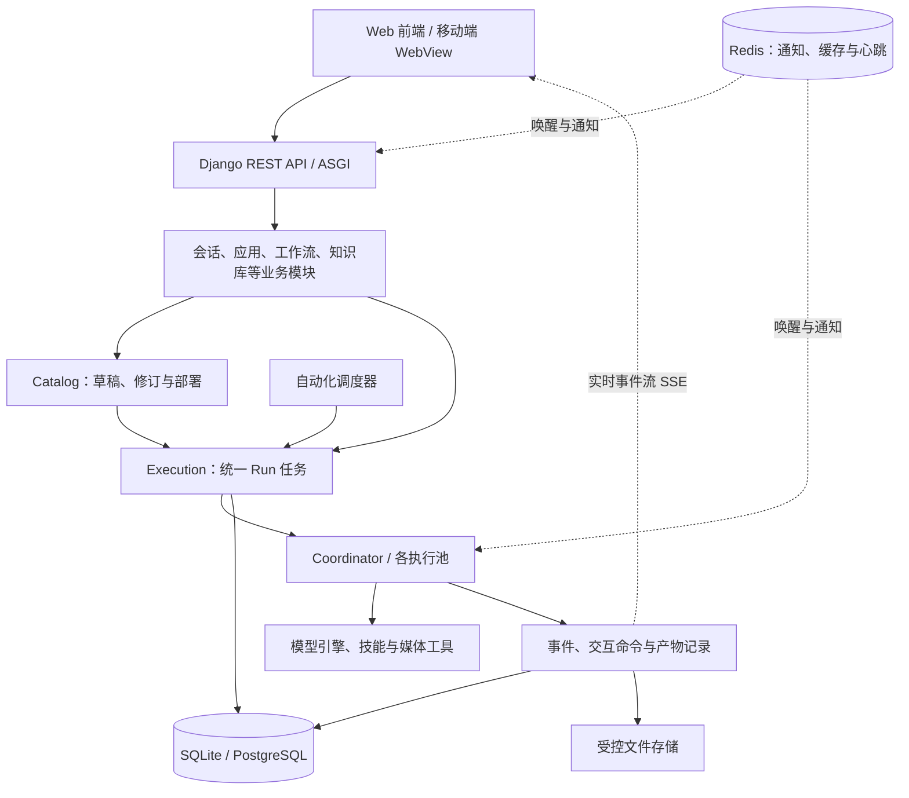

# Agent Studio 项目介绍

> 基于 2026 年 10 月 12 日的仓库源码、应用清单及配置整理。本文介绍项目定位与实现结构，不代表所有外部服务和应用能力均已在当前机器完成配置或运行验证。

## 1. 项目概述

Agent Studio 是一个集智能体对话、内容创作、知识管理、工作流和日常工具于一体的 AI 工作平台。用户可以直接使用应用中心里的场景应用，也可以围绕项目文件夹与 AI 持续协作，将多个应用组合成工作流，或通过自动化触发任务。

平台为应用提供统一的账号权限、模型执行、任务记录、实时输出和文件产物管理。具体场景由独立应用包承载，涵盖公众号与短视频创作、资料研究、会议整理、租房运营、学习辅助等领域。

项目支持本地运行、服务器部署和桌面打包，并提供 Android / iOS 移动端外壳。当前配置默认启用单租户模式；需要组织隔离的部署可以显式启用多租户模式。

### 适用人群

| 人群 | 典型用途 |
| --- | --- |
| 内容创作者与运营人员 | 选题、文案、排版、配图、动画和视频制作，对标分析与品牌资料复用 |
| 个人与小团队 | AI 对话、在线文档、资料研究、会议整理、文件管理与待办记录 |
| 开发者与技术内容作者 | 围绕代码目录协作，从源码提炼选题并生成有依据的讲解文案 |
| 有私有部署需求的组织 | 统一管理智能体、应用、工作流、知识库、成员权限与使用额度 |

## 2. 核心能力

### 智能体与项目协作

平台提供智能体配置、持续会话、项目及工作目录管理。聊天请求会创建持久化任务，用户可以查看执行进度、历史输出及产物，并在任务需要补充信息或审批时继续交互。

默认智能体引擎为 Codex；项目也保留可选的 GraphFlow 适配能力。具体可用模型、工具和技能取决于执行主机上的安装及认证配置。

### 应用中心

应用以 `application.yaml` 声明名称、类别、界面和执行配置，通过校验、数据库迁移和同步命令接入平台。应用既可以提供引导表单并衔接聊天，也可以拥有专用工作台和业务数据表。

截至本文整理时，`app_center` 的直接子目录中共有 **35 个带应用清单的应用包**。这是源码包数量，实际可见和可运行的应用还取决于同步、部署、权限及依赖配置。主要应用包括：

| 方向 | 代表应用 | 能力说明 |
| --- | --- | --- |
| 内容策划与写作 | 创作工具箱、公众号文章与选题应用、图文文案、短视频文案 | 从主题和资料生成选题、文章、逐页图文或口播文案 |
| 排版与图文交付 | 公众号排版引擎、Markdown 转 HTML、HTML 封面生成器、文章 HTML 配图、HTML 分页图文、HTML 批量转 PNG | 生成可编辑页面、公众号 HTML、分页图文及图片文件 |
| 图片与视频 | AI 绘图、动画制作、文案转剪映、创作大师 | 图片生成与参考图编辑、Remotion 动画、可编辑剪映草稿和媒体创作 |
| 品牌与内容研究 | 品牌资料库、案例库、抖音对标助手 | 管理品牌事实和范文，采集与分析对标作品，积累创作资料及脚本 |
| 文档与知识整理 | 在线文档、资料研究助手、会议与访谈助手 | 富文本编辑、成员共享、带出处的资料综合、录音转录与行动项整理 |
| 开发与提示词 | 仓库解读助手、提示词大师 | 基于源码生成选题及文案，通过交互澄清需求并生成、优化提示词 |
| 个人协作与文件 | 对话、随手记、我的网盘、我的电脑、微信助手 | 项目对话、想法待办、私人文件管理、远程访问和微信文本交互 |
| 垂直业务与生活 | 租房获客助手、学之有道、厨房助手 | 租房内容与客户跟进、学习辅助、菜谱与采购及食材管理 |
| 系统工具与游戏 | 磁盘清理大师、推箱子、口袋打捞队 | Windows 主机磁盘分析与确认清理，以及键盘和触屏游戏 |

### 工作流与自动化

工作流采用 DAG（有向无环图）编排，将应用组织为有依赖关系的步骤，支持条件分支、节点重试和有界并行。节点以独立子任务运行，父任务等待子任务时释放执行资源；需要用户输入时通过统一交互机制暂停和恢复。

自动化模块提供调度与 Webhook 触发能力，配合独立 scheduler 进程执行。任务记录仍沿用平台统一执行模型。

### 知识库与资料研究

组织知识库支持 PDF、DOCX、Markdown、TXT 和粘贴文本的提取、索引与有据问答。PostgreSQL 部署使用 pgvector / HNSW 与全文索引，SQLite 环境使用 sqlite-vec / FTS5；嵌入服务不可用时仍可进行词法检索。

资料研究助手提供个人研究项目，将选定资料保存为快照，生成研究报告、观点对照或写作资料包，并保留原文摘录和出处。它与组织知识库属于不同的产品入口。扫描版 PDF 需要先在外部完成 OCR。

### 权限与使用管理

平台具备账号、组织成员、角色、资源授权、审计和额度管理。多租户部署通过组织范围限制数据访问，PostgreSQL 部署还使用行级安全策略（RLS）。部分个人应用进一步按用户隔离业务资料，不能将“同一组织”理解为默认共享所有内容。

### 多端与远程访问

- **Web 端**：React 单页应用，承载主要产品界面和业务操作。
- **桌面端**：提供 Python 桌面启动器与打包脚本；创作大师另有独立的 Windows Qt 客户端。
- **移动端**：React Native WebView 外壳，连接用户填写的服务器网址，支持多窗口、下载、原生分享与安全凭据存储；网站与 API 仍由服务器提供。
- **我的电脑**：配对已授权的电脑，继续本机对话、使用远程终端和传输文件。终端及文件能力分别由电脑端启用，不提供远程桌面。

## 3. 技术架构

项目采用 **React 前端 + Django 模块化单体后端 + 独立执行进程**。API 服务、任务协调器、自动化调度器和连接器可以作为不同进程运行，共享领域模型与持久化数据。



### 三个关键模块

| 模块 | 职责 |
| --- | --- |
| Catalog | 管理 Agent、Skill、Application 的草稿（Draft）、不可变修订（Revision）和部署（Deployment），运行时使用已部署的定义版本 |
| Execution | 统一管理 Run、执行尝试、租约、队列、事件、交互命令、幂等记录和产物 |
| Tenancy | 提供组织范围查询、租户上下文和数据库隔离辅助能力 |

Agent、Conversation、Application、Workflow 和媒体执行都使用 `modules.execution.Run`。普通业务数据编辑仍由各应用 API 处理，并非每个操作都创建任务。

任务可以处于排队、运行、等待输入、等待子任务、成功、失败和取消等状态。数据库保存运行事实；Redis 用于通知、缓存及心跳，不是执行状态的最终来源。前端通过统一 Run 事件投影与 SSE 客户端处理增量输出、断线续接和历史恢复。

执行池分为 `agent`、`media`、`workflow`、`evaluation` 和 `knowledge`。SQLite 环境只运行一个 coordinator，可通过 `--worker-pool all` 轮询所有池；PostgreSQL 部署可按执行池拆分进程。

### 主要技术选型

| 层次 | 技术 |
| --- | --- |
| Web 前端 | React 18、TypeScript、Vite 7、React Router、Zustand |
| 界面与编辑 | Ant Design、Tailwind CSS、Tiptap、React Flow、xterm |
| 后端与 API | Python、Django 5.2、Django REST Framework、Daphne / ASGI、Channels |
| 数据与检索 | SQLite / PostgreSQL、Redis、pgvector、sqlite-vec、全文索引 |
| AI 与媒体 | Codex 适配器、可选 GraphFlow、Whisper、FFmpeg、Remotion、Playwright / Chromium |
| 移动端 | React Native、Android WebView、iOS WKWebView |
| 契约与测试 | OpenAPI、生成的 TypeScript 类型、Vitest、pytest、ESLint |
| 部署 | PowerShell / Shell 脚本、Docker Compose、桌面打包 |

## 4. 典型使用流程

### 内容创作

在品牌资料库准备账号定位、产品事实与写作样例，使用选题或对标应用确定方向，再由写作应用生成文章、图文或口播内容。用户审核后，可继续进行公众号排版、封面制作、分页图文、动画或剪映草稿制作。应用之间的交接方式取决于各自支持的入口，也可以由用户手动传递成果。

### 资料整理与办公

上传或导入文档，在资料研究助手中确定研究目标并选择资料，生成附带出处的成果，再导出为 Markdown 或保存为在线文档。录音可交给会议与访谈助手处理，经用户确认后将行动项保存为待办。

### 租房运营

维护房源和租客画像，生成平台文案与选题计划，手动发布后登记咨询、跟进和带看，最后记录成交及内容效果。应用提供内容建议与运营记录，发布、发送回复及效果录入仍由用户完成。

## 5. 仓库结构

```text
creation_agent_studio/
├── frontend/                  # Web 前端
│   └── src/
│       ├── router/            # 路由与应用页面入口
│       ├── pages/             # 产品页面与场景工作台
│       ├── layouts/           # 应用布局
│       ├── entities/run/      # 统一任务事件投影
│       ├── features/run-stream/ # 实时任务状态编排
│       ├── services/          # API 与事件流客户端
│       └── api/generated.ts   # 自动生成的接口类型
├── backend/
│   ├── backend/               # Django 配置、URL、ASGI 入口
│   ├── apps/                  # 智能体、会话、工作流、知识库等业务域
│   ├── modules/               # catalog、execution、tenancy
│   ├── app_center/            # 应用清单、运行逻辑与应用数据模块
│   ├── core/                  # 模型调用、存储等公共能力
│   ├── requirements/          # Python 依赖清单
│   ├── scripts/               # 校验、同步与运维脚本
│   ├── third_party/           # 第三方集成源码
│   ├── desktop_launcher.py    # 桌面启动入口
│   └── docker-compose.yml     # 容器服务编排
├── mobile/                    # Android / iOS 外壳
├── contracts/                 # API 与 Run 事件契约
├── teaching_data/             # 课程与答题卡数据子模块
├── deploy/                    # 部署配置与应用依赖映射
├── docs/                      # 部署、协议及专题文档
├── install-dependencies.ps1   # Windows 依赖安装
├── install-dependencies.sh    # Linux / macOS 依赖安装
├── deploy.ps1                 # Windows 本地启动
└── deploy.sh                  # Linux / macOS 本地启动
```

仓库包含创作大师、教学数据和抖音采集组件等 Git 子模块。首次获取源码应使用递归克隆，已有检出可执行 `git submodule update --init --recursive` 补齐锁定版本及嵌套依赖。

## 6. 本地运行与部署

### 基础环境

主项目要求 Python 3.11+（推荐 3.12）和 Node.js 20.19+ / 22.12+（推荐 24 LTS），并预先安装 Git。移动端及抖音采集组件有各自的运行环境要求；使用推荐版本后仍需按相应说明安装 SDK 或独立依赖。

以下 Windows 命令均从仓库根目录执行，后端 Python 使用项目虚拟环境 `backend\venv`。

### Windows 快速启动

首次安装依赖：

```powershell
powershell -ExecutionPolicy Bypass -File .\install-dependencies.ps1 -SystemDeps -WithCodex
```

安装脚本负责项目依赖及应用额外运行组件，不会代替模型登录、外部 Skill 安装和业务配置。更新已有环境时，应在相关服务停止后运行。

若需将全部内置应用同步到应用中心，安装完成后依次执行；每一步成功后再继续：

```powershell
.\backend\venv\Scripts\python.exe backend\manage.py validate_app_center
.\backend\venv\Scripts\python.exe backend\manage.py migrate --noinput
.\backend\venv\Scripts\python.exe backend\manage.py sync_app_center
```

启动本地开发服务：

```powershell
powershell -ExecutionPolicy Bypass -File .\deploy.ps1
```

启动脚本执行迁移、检查并按需创建管理员，单独同步“学之有道”“我的电脑”“微信助手”，并按配置启动前端、后端、执行协调器、自动化调度器和连接器。它不会自动同步全部应用，因此全量应用初始化使用上面的同步命令。首次没有管理员时会进入创建流程。

默认前端地址为 `http://localhost:3030`，后端为 `http://localhost:8080`，产品 API 统一使用 `/api/v1`。开发前端将 API 请求代理至后端。保留启动终端，按 Ctrl+C 结束本次启动的服务。

Linux / macOS 提供对应的 `install-dependencies.sh` 与 `deploy.sh`；完整安装、配置及生产操作见 [部署指南](DEPLOYMENT.md)。

### 部署形态

- **本地开发**：SQLite、Django ASGI 开发服务、Vite 和单个执行协调器。
- **服务器部署**：Docker Compose 编排 PostgreSQL、Redis、ASGI Web、各执行池、调度器及维护服务，前端由静态服务提供。
- **桌面分发**：使用仓库内桌面打包脚本封装本地运行入口。
- **移动接入**：移动外壳连接已部署的网站；Android / iOS SDK 和打包环境需另行准备。

生产入口需支持 SSE，并为远程连接器提供 WebSocket 转发。具体反向代理、数据库、存储与认证配置以部署指南为准。

## 7. 配置与能力边界

| 能力 | 需要准备的条件或当前边界 |
| --- | --- |
| 智能体生成 | 执行引擎安装、认证、模型可用性和使用额度 |
| Skill 驱动的创作应用 | 完整外部 Skill 目录及其脚本依赖；配置 `CODEX_SKILLS_DIRECTORY`，应用清单不会自动内置这些技能 |
| 转录、截图和动画 | 按应用安装 FFmpeg、语音模型、Chromium / Playwright 或 Remotion 等组件 |
| 抖音对标 | 独立 DTK Python 环境与个人采集配置，实际可用性受平台接口和登录状态影响 |
| 文案转剪映 | 生成可编辑工程，配音需要可用 TTS；该应用本身不导出 MP4 |
| 资料提取 | 文字型 PDF、DOCX 等；扫描资料需外部 OCR |
| 远程访问 | 在线电脑、运行中的连接器、完成配对及启用相应权限 |
| 磁盘清理 | Windows 后端主机、平台管理员权限，以及预览后的明确确认 |

## 8. 开发与维护入口

前端以 `services/api.ts` 为统一 REST 入口，以 `services/runStream.ts` 处理任务事件流，接口类型由后端契约生成。新增长任务应接入既有 Run 模型；新增应用应遵循 App Center 的清单、迁移和同步机制。

常用检查命令如下，需先安装相应开发依赖：

```powershell
# 前端测试、静态检查与生产构建
npm.cmd --prefix frontend run test
npm.cmd --prefix frontend run lint
npm.cmd --prefix frontend run build

# 后端测试：始终使用项目虚拟环境
.\backend\venv\Scripts\python.exe -m pytest -c backend\pytest.ini backend

# 应用清单检查
.\backend\venv\Scripts\python.exe backend\manage.py validate_app_center
```

本文整理执行了源码、清单和配置检查，未运行上述全量测试、启动服务或验证外部平台连接。移动布局和真实设备行为也不能由静态文档检查推断。

## 9. 延伸阅读

- [项目 README](../README.md)：安装、启动及整体说明。
- [架构分析](../ARCHITECTURE_ANALYSIS.md)：统一执行模型、版本管理与架构取舍；阅读时注意分析日期。
- [企业部署与运维](../ENTERPRISE.md)：组织权限、治理和生产运行。
- [部署指南](DEPLOYMENT.md)：容器、本地启动和远程访问配置。
- [应用中心说明](../app_center/README.md)：应用包规范和外部技能依赖。
- [移动端说明](../mobile/README.md)：Android / iOS 功能、环境及构建。
- [远程访问 API](REMOTE_ACCESS_API.md)：电脑配对、终端和文件传输协议。
- [成员 Token 配额](MEMBER_TOKEN_QUOTAS.md)：使用额度管理。
- [开发约定](../AGENTS.md)：虚拟环境、浏览器兼容和移动布局要求。
